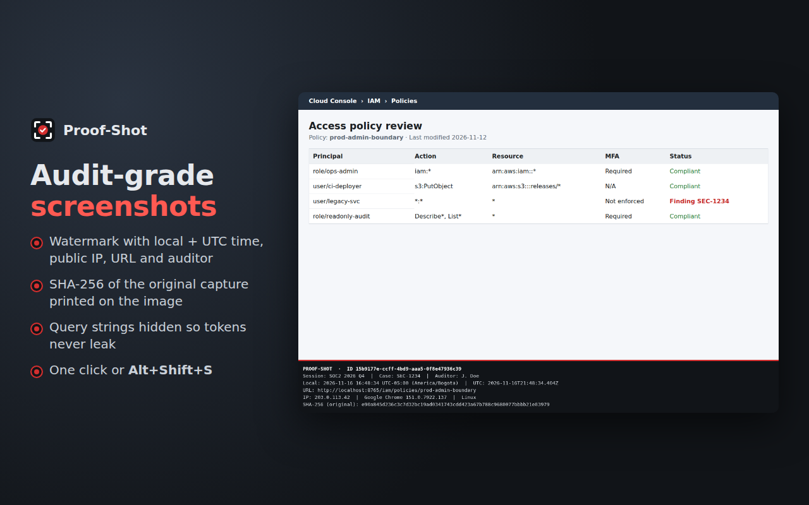

# Proof-Shot

[](https://github.com/saqpsaqp/chrome-screenshot-for-audit/actions/workflows/ci.yml)
[](https://github.com/saqpsaqp/chrome-screenshot-for-audit/actions/workflows/security.yml)
[](https://github.com/saqpsaqp/chrome-screenshot-for-audit/actions/workflows/codeql.yml)
[](https://scorecard.dev/viewer/?uri=github.com/saqpsaqp/chrome-screenshot-for-audit)

Chrome extension (Manifest V3) that takes **audit-grade screenshots**: each capture gets a visible watermark band and a JSON evidence sidecar with SHA-256 hashes, so evidence can be verified later.



## Features

- **Visible-area capture** from the popup or a keyboard shortcut (default `Alt+Shift+S`, configurable at `chrome://extensions/shortcuts`).
- **Watermark band** below the screenshot (it never covers page content) with:
  evidence ID, session, case/ticket ID, auditor, local time + timezone, UTC time, URL (**origin + path only**, query string and fragment are dropped to avoid leaking tokens), public IP, browser/OS and the SHA-256 of the original capture.
- **JSON sidecar** with full metadata (full URL, page title, user agent) and both hashes.
- **Sessions**: a session name is required before capturing. Files are organised as:
  ```
  Downloads/<root folder>/<session>/<YYYY-MM-DD>/<HHMMSS>_<case>_<id8>.png
                                                 <HHMMSS>_<case>_<id8>.json
  ```
- **Local history log** (last 2000 captures) with CSV export (formula-injection safe) from the Settings page.

## Verifying evidence

```bash
sha256sum 164012_SEC-1234_7c1e2a9b.png
jq -r .integrity.sha256_final 164012_SEC-1234_7c1e2a9b.json
```

Both values must match. `sha256_original` is the hash of the raw screenshot before the watermark was applied; it is printed on the watermark itself.

## Installation (development)

1. Open `chrome://extensions/` and enable **Developer mode**.
2. Click **Load unpacked** and select this folder.
3. Pin the extension, open the popup and start a session.

## Development

```bash
npm ci                # dev tooling only (ESLint); the extension has no runtime deps
npm run lint          # ESLint with security + no-unsanitized rules
npm test              # unit tests + manifest/source security policy
npm run test:e2e      # real captures in headless Chrome (CHROME_BIN to override)
```

### CI/CD

| Workflow | Trigger | What it does |
|---|---|---|
| `ci.yml` | PR, push to `main` | Lint, unit + policy tests, E2E in headless Chrome, builds the store zip as an artifact |
| `security.yml` | PR, push to `main`, weekly | gitleaks, Semgrep (SARIF to code scanning), zizmor, dependency review, npm audit |
| `codeql.yml` | PR, push to `main`, weekly | CodeQL `security-extended` for JavaScript and GitHub Actions |
| `scorecard.yml` | push to `main`, weekly | OpenSSF Scorecard |
| `release.yml` | tag `vX.Y.Z` | Full test suite, zip + SHA256SUMS, build provenance attestation, GitHub release |

Release: bump `version` in `manifest.json` and `package.json`, merge, then `git tag vX.Y.Z && git push origin vX.Y.Z`. Upload the release zip to the Chrome Web Store.

## Packaging and publishing

```bash
./pack.sh          # -> proof-shot-v<version>.zip (upload to the Chrome Web Store)
store/build.sh     # re-render store screenshots and promo tile from store/src/*.html
```

Listing texts, permission justifications and data disclosures: [store/STORE_LISTING.md](store/STORE_LISTING.md).

## Privacy

Full policy: [PRIVACY.md](PRIVACY.md). Security model and vulnerability reporting: [SECURITY.md](SECURITY.md).

- The only network request is to `https://api.ipify.org` to get the public IP at capture time.
- Everything else stays local: settings, session and history live in `chrome.storage.local`; evidence files go to your Downloads folder.
- Permissions: `activeTab` (capture only the tab you act on), `downloads`, `storage`.

## Roadmap

- [x] v1.0: visible capture, watermark, JSON sidecar, sessions, shortcut, history, store assets
- [ ] v1.1: region selection

## License

[MIT](LICENSE) © 2026 Saul Quintero

---

Made by [Saul Quintero](https://saulquintero.com.co/utilities/)
